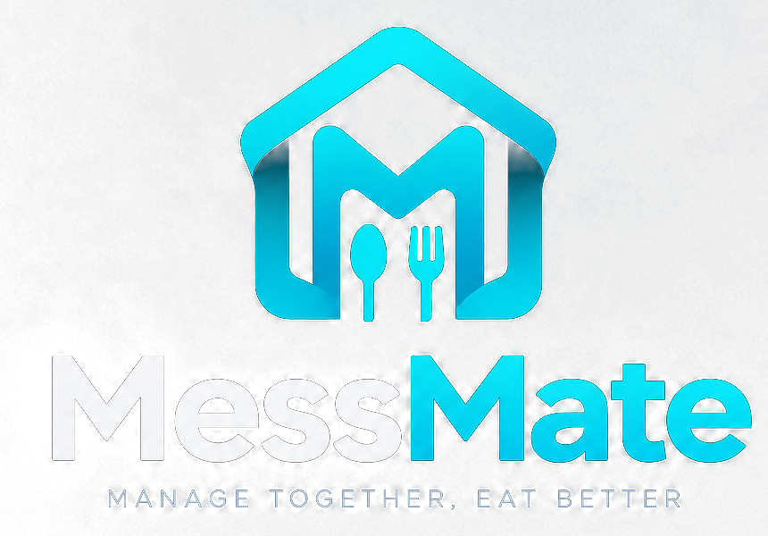
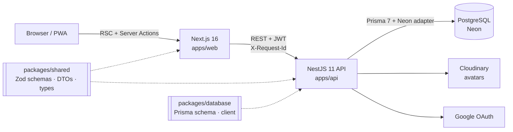

<div align="center">



# MessMate

**Meal, bazaar and expense accounting for shared bachelor messes, with no more month-end spreadsheet math.**

[**Live Demo**](https://messmate.sadal.dev/) · [Architecture](#architecture) · [Engineering Highlights](#engineering-highlights) · [Run Locally](#getting-started)


-4169E1?logo=postgresql&logoColor=white>)


</div>

---

## Try it

| Role                  | Email                        | Password        |
| --------------------- | ---------------------------- | --------------- |
| Manager (full access) | `demo.manager@messmate.demo` | `MessMate@2026` |
| Member                | `demo.member@messmate.demo`  | `MessMate@2026` |

The demo mess, _Green Villa Bachelor Mess_, has 8 members, a **closed October 2026** with final bills and carried-forward balances, and an **active November 2026** with daily meals, bazaar submissions waiting for approval, shared bills and deposits.

<!--
## Screenshots

| Dashboard | Daily meal entry |
| --- | --- |
|  |  |

| Bazaar approval | Month-close summary |
| --- | --- |
|  |  |
-->

## Why I built it

I live in a bachelor mess in Dhaka. Every month one of us had to add up who ate how many meals, who went to the bazaar and spent what, split the cook's salary and the electricity bill, subtract deposits, and then argue about the numbers in a group chat. It took hours and someone always found a mistake.

MessMate replaces that. **All 8 members of my mess used it to run October 2026**: managers record meals every night, members submit their bazaar receipts, and closing the month produces every member's final bill and carries balances into the next month automatically.

## Features

- **Mess and roles:** create a mess, invite members or create accounts for them, with up to two managers who have equal permissions.
- **Daily meal grid:** one screen to record everyone's meals for a day. Meal types and their weights are configurable per mess.
- **Bazaar workflow:** members submit itemised grocery runs, and a manager approves (which posts the expense) or rejects them.
- **Three expense types:**
  - _Bazaar_ costs set the meal rate.
  - _Shared_ bills (rent, cook, Wi-Fi) are split equally to the paisa.
  - _Individual_ charges go to one member.
- **Deposits and live balances:** members always see their meal rate, current bill and balance.
- **Month lifecycle:** the manager closes the month, which archives it, computes every member's final bill, and opens the next month with each balance carried forward as a credit or a due.
- **Reports and history:** per-member and per-day meal reports, archived month summaries, and a full activity log of every change.
- **Accounts:** email/password or Google sign-in, per-device sessions, avatar upload, and profile and password management.
- **Polished UI:** dark/light theme, English and বাংলা (Bengali), mobile-first layout, installable PWA with an offline page.

## Tech stack

| Layer    | Technology                                                                                                               |
| -------- | ------------------------------------------------------------------------------------------------------------------------ |
| Frontend | Next.js 16 (App Router, Server Actions), React 19, TanStack Query, Zustand, Tailwind CSS v4, Radix primitives, next-intl |
| Backend  | NestJS 11, Passport (JWT + Google OAuth 2.0), Zod validation, @nestjs/throttler                                          |
| Data     | PostgreSQL on Neon (serverless), Prisma 7 with the Neon driver adapter                                                   |
| Shared   | `@repo/shared`: Zod schemas, DTOs and response types used by **both** apps                                               |
| Infra    | Turborepo + pnpm workspaces, Vercel (web), Render (API), Cloudinary, GitHub Actions CI with remote caching               |

## Architecture



```
apps/
  web/        Next.js 16: pages, server actions, React Query hooks, i18n, PWA
  api/        NestJS 11: auth, messes, meals, bazaar, expenses, deposits, months
packages/
  database/   Prisma schema, migrations, lazy Neon client
  shared/     Zod schemas + TypeScript types shared by web and api
context/      Product spec, database design, 24 Architecture Decision Records
```

The browser never talks to the API directly. Server Actions call it with the access token from an HTTP-only cookie, so tokens are never exposed to client JavaScript.

## Engineering highlights

**Correct money math, atomically.** Closing a month archives it, computes every member's summary, opens the next month, writes carry-forward balances and logs the action in a **single database transaction**. The status-guarded update acts as a lock, so a meal saved while the month is closing can't be left out of the bill. The calculation is a pure, Prisma-free function (`month-summary.ts`) that can be unit-tested on its own, and it's written so shared bills are never counted twice in the meal rate.

**Documented decisions.** Before the code there were **24 Architecture Decision Records** (`context/architecture-decisions.md`): one active mess per user, at most two managers, JSONB meal storage instead of a join table, soft deletes, timestamp-based membership, and the carry-forward rules.

**One validation contract, two apps.** Request bodies are validated with Zod schemas from `@repo/shared`. The web app imports the same package (the auth forms validate with the exact schemas the API enforces), so request and response types can't drift between client and server.

**Auth done properly.**

- Short-lived access tokens with 30-day sliding refresh sessions.
- **Per-device sessions** that store only a SHA-256 hash of each refresh token, so any device can be revoked.
- Transparent refresh on a 401, followed by one retry.
- Google OAuth with account linking.
- bcrypt password hashing.
- Per-user rate limiting, with stricter limits on auth routes.

**Consistent, safe errors.**

- Every response uses the same `{ success, message, data }` envelope.
- Errors carry a machine-readable `code` and a `requestId` that is also sent as the `X-Request-Id` header.
- Prisma errors map to the right HTTP status (unique violation → 409, missing record → 404, database unreachable → 503).
- 5xx details are logged as structured JSON and never leaked to the client.

**Frontend that doesn't lie.** Server Actions return a typed `ActionResult` instead of throwing, because Next.js hides thrown error messages in production. A failed load shows an error state, never an empty state. Otherwise a network blip could look like "no active month" and offer the manager a destructive "Start Month" button.

**Role-based access at the edge of every route.** NestJS guards check JWT → mess membership → manager role against the `:messId` in the URL, so one mess can never read or write another's data.

**Serverless-ready.** The same NestJS app runs as a long-lived server (local dev, Render in production) or as a lazily bootstrapped Vercel serverless function, from one entry point.

## Getting started

**Prerequisites:** Node.js 20+, pnpm 9, and a PostgreSQL database (a free [Neon](https://neon.tech) project works).

```bash
git clone https://github.com/AdalOnShow/MessMate-Turborepo.git messmate
cd messmate
pnpm install
```

Create a `.env` in the repo root (see `apps/api/.env.example` for every option):

```bash
DATABASE_URL=postgresql://...
JWT_ACCESS_SECRET=<64-char hex>
JWT_REFRESH_SECRET=<64-char hex>
CORS_ORIGIN=http://localhost:3000
# optional: GOOGLE_CLIENT_ID / GOOGLE_CLIENT_SECRET, CLOUDINARY_*
```

and `apps/web/.env.local`:

```bash
NEXT_PUBLIC_API_URL=http://localhost:4000
```

Apply the schema, build the shared packages, and load the demo mess:

```bash
cd packages/database && pnpm prisma migrate deploy && cd ../..
pnpm turbo build --filter=@repo/database --filter=@repo/shared
pnpm --filter api seed:demo          # add --reset to rebuild it later
```

Run both apps:

```bash
pnpm turbo dev --filter=api          # http://localhost:4000
pnpm turbo dev --filter=web          # http://localhost:3000
```

### Useful commands

```bash
pnpm turbo build                     # build everything
pnpm turbo lint                      # ESLint (warnings fail CI)
pnpm turbo check-types               # TypeScript across the monorepo
pnpm --filter api test               # Jest unit tests
```

## Roadmap

- [ ] Unit and e2e tests for the accounting flows
- [ ] PDF / CSV export of monthly bills
- [ ] Push notifications for bazaar approvals and month close
- [ ] Mobile app reusing `@repo/shared`
- [ ] Multi-tenant SaaS mode (designed for in ADR-019)

## Author

**Sharif Adal**: full-stack developer

[Portfolio](https://sharifadal.me) · [LinkedIn](https://linkedin.com/in/adalonshow) · [adalonshow@gmail.com](mailto:adalonshow@gmail.com)
